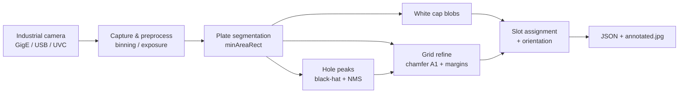

# Centrifuge Tube Rack Vision / 离心管反光孔板视觉识别

> **Industrial computer-vision pipeline** for a **6×4 reflective tube rack**: live capture from **Hikrobot (Hikvision) GigE/USB** cameras, **slot-level occupancy**, and **cap orientation** for automation / lab logistics.  
> **工业场景计算机视觉**：海康工业相机实时取流，对反光孔板做孔位编号、占位检测与白盖朝向估计，输出 JSON 与可视化，便于对接机械臂或 LIMS。

---

## Highlights

| 维度 | 内容 |
|------|------|
| **问题** | 俯视黑色反光孔板上的离心管：板子可旋转、缺角定原点、白盖与空孔对比度有限，需要稳定 **A1–D6 级** 结构化结果。 |
| **方法** | 经典 CV（OpenCV）：板区域分割 → 缺角 chamfer 定 **A1** → 孔洞峰点 + 白盖 blob **联合 refine 网格** → 最近邻占位 + 铰链角/统一补偿角。 |
| **工程** | 海康 **MVS SDK** 封装（GigE 网段、USB 选型、曝光增益）、Tkinter **实时 GUI**（对焦预览、相机下拉、结果表格）、一键脚本 `run_camera.sh`。 |
| **输出** | 每孔：`slot_id`、`occupied`、`cx/cy`、置信度、`hinge_angle_deg`、`rotate_to_unify_deg`；落盘 `result.json` + 标注图。 |
| **栈** | Python 3.10+ · OpenCV · NumPy · Pillow · Hikrobot MVS（Linux `/opt/MVS`） |

---

## Demo flow / 使用流程

```text
选相机 → 对焦预览（调镜头）→ 停止 → 开始实时识别 → 保存 JSON+图
```

> **GitHub 展示建议**：将 `results/*/annotated.jpg` 或 GUI 截图放到 `docs/demo.jpg`，并在 README 顶部加 ``。

---

## Architecture / 算法流程



**核心模块**

1. **`find_plate_rect`**：分割黑色孔板，得到位姿（中心、长边、倾角）。
2. **`detect_hole_centers`**：反光圆孔峰点（用于网格对齐，默认目标 **24 孔**）。
3. **`plate_quad_for_grid` + `refine_grid`**：缺角角点作 **A1** 原点；边距在合理范围内搜索，使网格与孔洞/白盖对齐。
4. **`detect_cap_blobs` + `assign_blobs_to_slots`**：白盖斑点匹配孔心，过滤低置信度占位。
5. **`estimate_hinge_angle`**：占位管的突耳/铰链方向与 **统一放向角**（配置见 `rack_config.UNIFY_TARGETS_DEG`）。

---

## Repository layout / 目录说明

```text
离心管/
├── tube_detect.py      # 检测主算法（detect_tubes）
├── rack_config.py      # 网格 6×4、阈值、A1 缺角策略
├── hik_camera.py       # 海康 MVS 相机封装（取流、曝光、Binning）
├── camera_backend.py   # 相机入口：海康 / OpenCV UVC
├── main_detect.py      # CLI：单帧或 --loop 实时识别
├── gui_detect.py       # Tkinter GUI（推荐演示）
├── run_camera.sh       # 环境变量 + GigE 辅 IP + 启动入口
├── check_cam.py        # 枚举相机、试拍一帧
├── camera_preview.py   # 纯预览（快捷键调曝光）
├── camera.env.example  # 复制为 camera.env 后改网卡/IP/曝光
├── MvImport/           # 海康 Python 绑定（需本机安装 MVS SDK）
├── samples/            # 示例静态图（可选离线调试）
└── results/            # 运行输出（建议不上传 GitHub，见 .gitignore）
```

---

## Requirements / 环境依赖

### 系统

- **Linux**（已在 Ubuntu + 海康 MVS 4.x 下验证）
- [Hikrobot MVS](https://www.hikrobotics.com/) 安装于 `/opt/MVS`（`libMvCameraControl.so`）
- GigE 相机：网卡需与相机同网段（脚本可自动加 **辅 IP**，见 `camera.env`）

### Python

```bash
python3 -m venv .venv
source .venv/bin/activate
pip install -r requirements.txt
```

| 包 | 用途 |
|----|------|
| opencv-python | 图像处理与显示 |
| numpy | 数组运算 |
| Pillow | GUI 图像显示 |

> **注意**：运行前请 **关闭海康 MVS 客户端**，否则会独占相机。

---

## Quick start / 快速开始

```bash
chmod +x run_camera.sh
cp camera.env.example camera.env   # 按需改 GIGE_IF、GIGE_HOST_IP、EXPOSURE、GAIN

# 检查相机
./run_camera.sh --check

# GUI（对焦 + 实时识别，推荐答辩/面试演示）
./run_camera.sh --gui

# USB 海康（跳过 GigE 辅 IP）
./run_camera.sh --usb --gui

# 命令行：拍一帧并识别
./run_camera.sh --once --show
```

### GUI 要点

- **相机**下拉：海康自动 / GigE / USB / UVC。
- **对焦预览**：仅 live view + 清晰度数值，**不跑识别**。
- **加亮**：自动提高曝光/增益并刷新流。
- 默认网格 **6 行 × 4 列**（`rack_config.py` 或 GUI 可改）。

### 常用环境变量（`camera.env`）

| 变量 | 含义 |
|------|------|
| `GIGE_IF` / `GIGE_HOST_IP` | GigE 网卡与辅 IP |
| `CAM_DEVICE_TYPE` | `usb` / `gige` |
| `CAM_BACKEND` | `hik` / `opencv` |
| `EXPOSURE` / `GAIN` | 默认曝光 μs、增益 dB |

---

## Output format / 输出说明

每次保存会在 `results/<timestamp>/` 生成：

| 文件 | 说明 |
|------|------|
| `raw.jpg` | 原图 |
| `annotated.jpg` | 孔板框、网格、占位标注 |
| `mask_plate.jpg` | 板区域 mask |
| `result.json` | 结构化结果 |

**JSON 摘要字段**

```json
{
  "algorithm": "plate_rect_grid_then_white_cap_assign",
  "occupied_count": 7,
  "occupied_slots": ["A1", "B2"],
  "plate": {
    "grid_rows": 6,
    "grid_cols": 4,
    "center_full": [1064.7, 756.9],
    "angle_deg": -89.7,
    "a1_at": "chamfer_corner"
  },
  "items": [
    {
      "slot_id": "A1",
      "occupied": true,
      "cx_full": 493.9,
      "cy_full": 175.8,
      "hinge_angle_deg": 12.4,
      "rotate_to_unify_deg": -77.6,
      "rotate_direction": "ccw",
      "confidence": 0.82
    }
  ]
}
```

坐标 **`cx_full` / `cy_full`** 为全图像素，可直接用于标定后的机械臂抓取或 UI 回显。

---

## Configuration / 调参入口

主要阈值与几何假设在 **`rack_config.py`**：

- `GRID_ROWS` / `GRID_COLS`：孔板规模（默认 6×4）
- `ORIGIN_AT_CHAMFER_CORNER`：缺角为 A1
- `MIN_OCCUPY_CONFIDENCE`：占位置信度下限
- `CAP_*`：白盖分割面积与亮度阈值

换板型（如 12×8）时修改行列并 **关闭** 易误判的 `AUTO_DETECT_GRID`。

---

## Limitations & future work / 局限与延伸

- 当前为 **传统 CV**，强依赖光照与反光材质；极端阴影或强反光需现场调曝光。
- 未内置手眼标定；与机器人对接需在外部做像素→世界坐标变换。
- 可延伸：深度学习分割、多 rack 跟踪、与 ROS2 / 实验室 LIMS 集成。

---

## Author / 作者

- **GitHub**：[@chelsea11100](https://github.com/chelsea11100)
- **Repository**：https://github.com/chelsea11100/centrifuge-tube-rack-vision

**CV 引用示例**

> *Centrifuge Tube Rack Vision* — classical CV pipeline for reflective 6×4 tube plates with Hikrobot industrial cameras, slot occupancy and cap orientation export.  
> GitHub: https://github.com/chelsea11100/centrifuge-tube-rack-vision

---

## License

项目代码以学习 / 科研展示为主。`MvImport/` 与海康 MVS SDK 版权归 **Hikrobot** 所有，分发或商用请遵循其官方许可；本仓库不包含 MVS 安装包。
